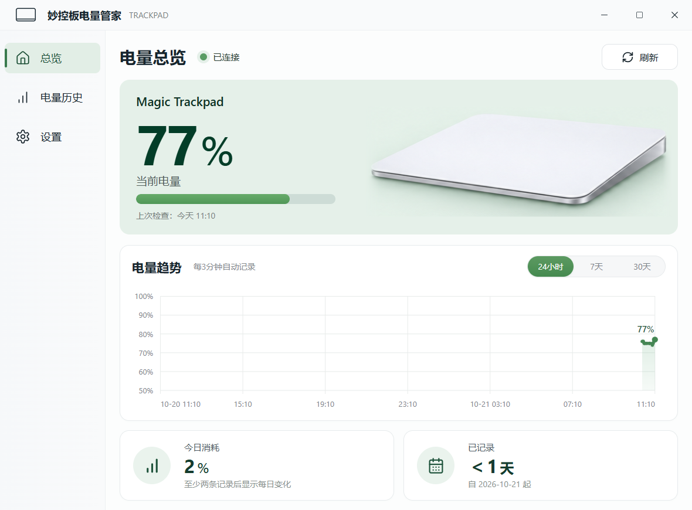
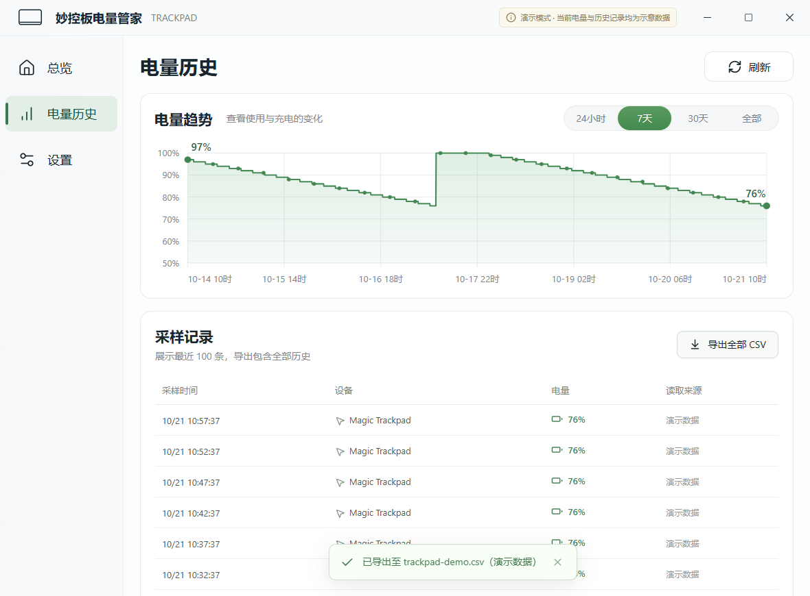
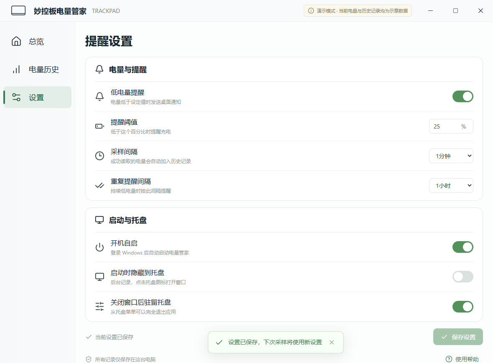
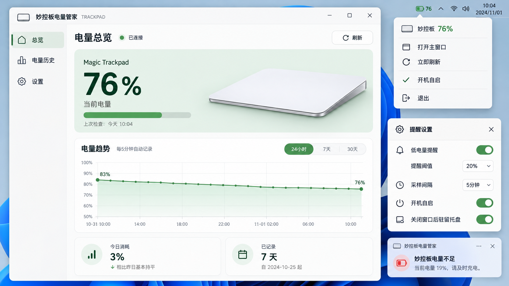
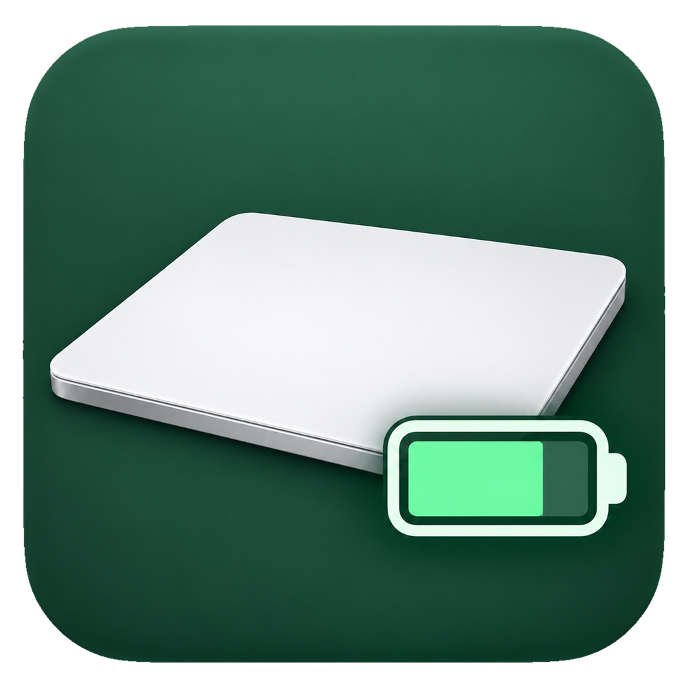

# 妙控板电量管家

**MagicTrackpadBluetoothBatteryLevel** 是面向 Windows 的 Apple Magic Trackpad 电量工具，使用 **Tauri 2 + Rust + React + TypeScript** 开发。界面沿用项目的薄荷绿视觉原型与应用图标。

## 界面预览

### 实际运行界面

下面的截图来自正式桌面程序连接真实妙控板后的运行界面。电量、历史曲线和统计值均为截图时的实际记录。



<details>
<summary>查看电量历史和设置页面</summary>

以下两张截图使用带有明确标记的演示数据，展示历史筛选、CSV 导出及提醒设置。





</details>

### 设计稿与应用图标





[下载 Windows ICO 图标](design/trackpad-battery.ico)。托盘使用该图标，实时电量显示在悬停提示和右键菜单中。

截图、设计稿和图标均已随源码纳入仓库，以上图片使用仓库内的相对路径。

## 功能

- 查询 Lightning 款妙控板电量，支持手动刷新与自动采样。
- 显示最近 24 小时、7 天、30 天或全部历史，鼠标悬停和左右方向键可查看采样点。
- SQLite 保存真实采样记录，断连和读取失败不写入虚构电量；可导出全部记录为 CSV。
- 设置低电量提醒阈值，默认 **低于 20%** 提醒，持续低电量默认每小时最多再次提醒一次。
- 系统托盘固定使用 `design/trackpad-battery.ico`，悬停提示和右键菜单显示实时电量，提供打开窗口、立即检查、开机自启与退出菜单。
- 总览按 `design/trackpad-battery-prototype.png` 还原标题栏、导航、电量卡片、曲线和「今日消耗 / 已记录」两张统计卡，插画直接取自设计稿。今日消耗累计下降的电量，充电增加部分不会抵消消耗；统计使用本地日历日期。
- 关闭窗口后继续后台采样，可选择启动时隐藏到托盘。
- 开机自启使用当前用户的 Windows 登录启动项，默认关闭，可在设置中开启。

## 开发环境

需要 Windows 10/11、Node.js 20.19+（或 Node.js 22.12+）、Rust stable、MSVC C++ 构建工具、Windows SDK 和 WebView2 Runtime。

```powershell
npm install
npm run desktop
```

开发服务器固定为 `http://127.0.0.1:1420`。只运行 `npm run dev` 时是浏览器预览，不能读取 HID 或使用托盘功能。

浏览器打开 `http://127.0.0.1:1420/?demo=1` 可查看带有明确提示的演示数据。演示模式只存在于普通浏览器预览中，不会将演示数据写入桌面应用或真实数据库。

## 构建

```powershell
npm run desktop:build
```

生成的独立程序位于 `src-tauri/target/release/magic-trackpad-battery.exe`，NSIS 安装包位于 `src-tauri/target/release/bundle/nsis/`。桌面成品不依赖 Python、Node.js 或常驻网页服务器；Windows 需要安装 WebView2 Runtime。

建议安装到稳定位置后再开启开机自启。如果移动独立 EXE，请重新保存一次开机自启设置以更新程序路径。

## 使用

1. 在 Windows 蓝牙设置中连接并唤醒妙控板，启动应用。
2. 在总览查看电量，默认每 5 分钟自动读取并记录。
3. 在「设置」调整提醒阈值、采样间隔、自启与托盘行为，并点击「保存设置」。
4. 默认关闭主窗口会隐藏到托盘。左键点击托盘图标打开窗口，右键选择「退出」才会完全停止采样。
5. 在「电量历史」导出 CSV，导出包含本机数据库中的全部历史。

Windows 专注模式、系统通知权限会影响提醒的可见性。为避免读取驱动时阻塞整个应用，HID 查询在隔离的短时子进程中执行，超过 10 秒会终止并等待下次采样。

## 设备支持与数据

电量读取针对 **Lightning 款 Magic Trackpad（Apple VID `05AC` / `004C`，常见 PID `0265`）**，优先尝试 Apple Multi-touch Auxiliary Services 暴露的 HID 集合。查询 `0x90` 输入报告并从第三个字节读取 0～100 的电量，不读取触控输入流，不替换设备驱动，不推测充电标志。

不同驱动可能不向应用暴露此接口。无法读取时，界面显示连接/读取错误，历史仍会保留。此项目没有对第一代 AA 电池型号及所有 USB-C 设备完成兼容验证。

数据库使用 Tauri 的应用数据目录，Windows 通常为 `%APPDATA%\com.trackpad.battery\battery.sqlite3`。提醒冷却状态和偏好设置也保存在此数据库中。应用运行时不上传电量、设备信息或历史记录。

## 检查

```powershell
npm run build
npm run test:rust
npm run test:ui
```

界面检查使用 Playwright 和本机 Microsoft Edge，涵盖真实未知状态不显示假电量、历史范围切换和 CSV 导出、设置保存与撤销、基本键盘交互和窗口宽度适配。截图和临时检查结果输出到 `artifacts/`。

构建完成且实际妙控板已连接时，可运行 Windows 原生联调：

```powershell
npm run test:native
```

该检查启动正式程序，通过仅对本次进程生效的 WebView2 调试参数验证真实读取、SQLite 持久化、设置校验、Windows 登录启动项、关闭到托盘、隐藏后自动采样和单实例唤回。检查会临时修改采样及自启设置，结束时恢复原设置并退出测试进程；不会在成品中启用调试端口。

2026-10-21 已在本机完成：前端生产构建、11 项 Rust 测试、4 项界面测试和上述正式版本原生联调。实际设备读取成功，开发服务器关闭后正式程序仍能独立工作；自绘标题栏的最大化、还原、关闭到托盘、隐藏后自动采样、单实例唤回均已验证，未发现前端运行错误。测试保留用户已有设置与历史记录。

## 项目结构

- `src/`：React 界面、SVG 历史曲线与 Tauri 命令封装。
- `src-tauri/src/`：HID 读取、SQLite 存储、提醒策略、托盘、自启和应用命令。
- `public/`：应用图标与生图脚本生成的触控板插画。
- `design/`：原型图与图标源文件。
- `docs/images/`：README 使用的界面截图。

本地生图辅助脚本不纳入 Git，也不参与桌面应用运行或打包。仓库已包含构建所需的设计素材。
